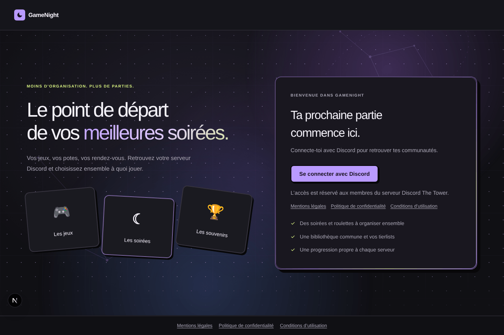
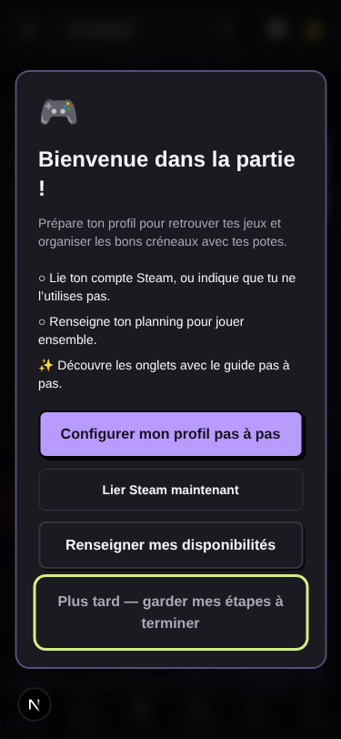
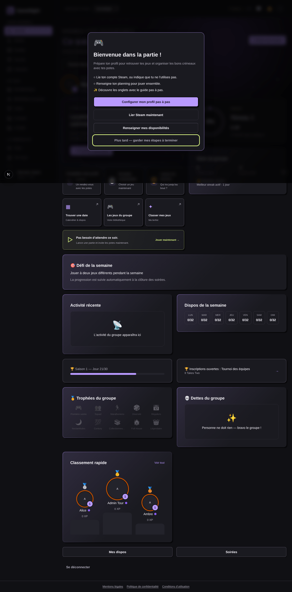
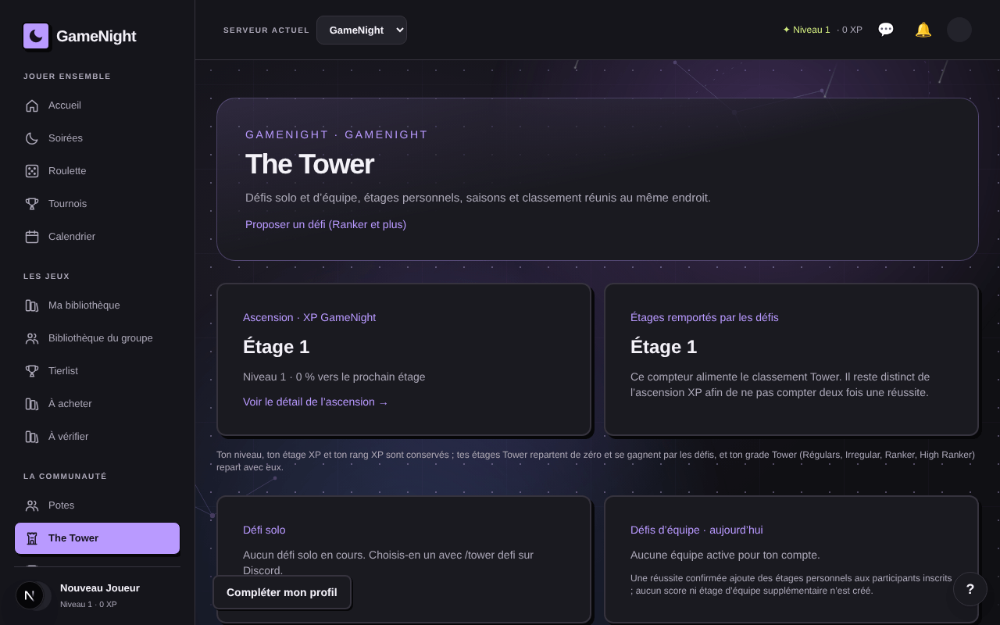
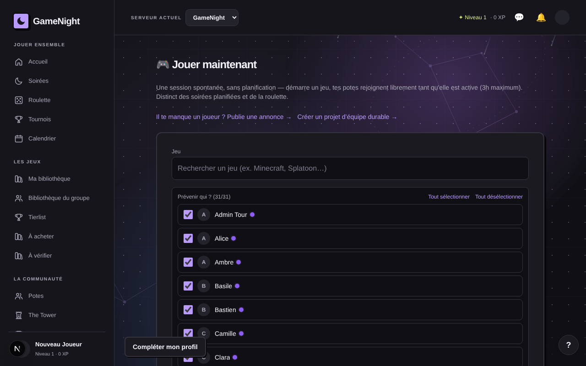
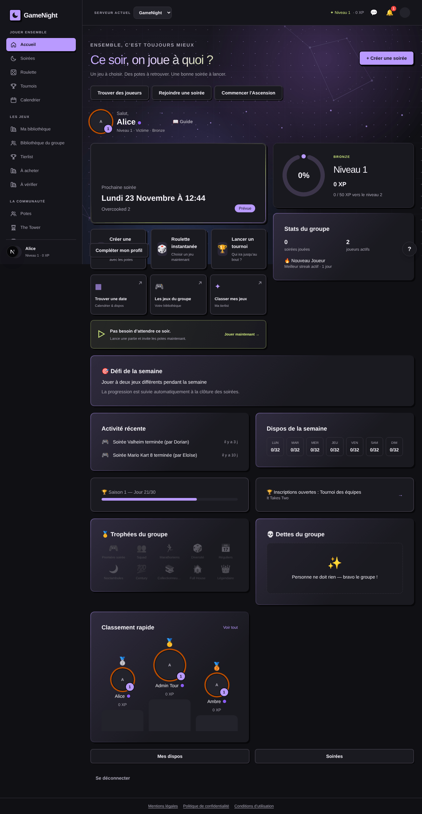
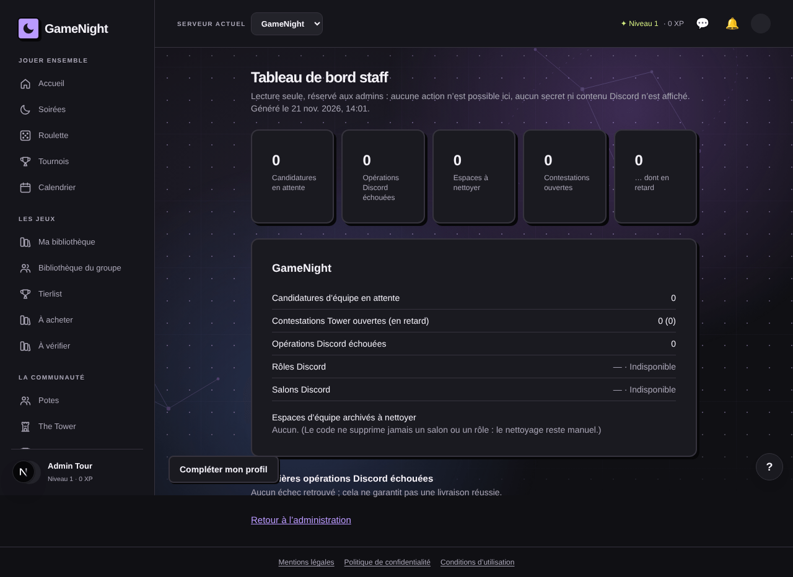

# Preuves : captures et parcours du nouveau joueur

Branche `preuves/20261121`, **Draft, jamais fusionnée**. Application lancée en local (PostgreSQL jetable, tous les `*_ENABLED` à `true`, aucune clé externe, aucun appel Discord/Vercel/Neon), avec 1 communauté, 31 membres actifs, 3 équipes, 5 soirées, 2 tournois, 5 défis et 1 booster ; trois profils simulés : nouveau joueur sans donnée, joueur actif, administrateur. Aucune correction de code dans cette PR.

## Résultat en une table

| | Total | FONCTIONNE | PARTIEL | NE FONCTIONNE PAS | NON TESTABLE EN LOCAL |
| --- | ---: | ---: | ---: | ---: | ---: |
| Lignes du cahier | 127 | 57 | 8 | 5 | 57 |
| Décisions du 18/11 | 20 | 11 | 1 | 2 | 6 |

Aucun FONCTIONNE sans preuve exécutée (test réussi ou scénario). 57 fichiers de test exécutés : 980/981 tests réussis. 260 captures PNG (mobile 375 px et bureau 1280 px, chacune sous 300 ko).

## Documents

| Document | Contenu |
| --- | --- |
| [RAPPORT.md](RAPPORT.md) | Totaux, NE FONCTIONNE PAS et PARTIEL avec correction et effort, 10 frictions classées |
| [TRACABILITE.md](TRACABILITE.md) | Les 127 lignes du cahier et les 20 décisions : scénario exécuté, résultat, lien vers le test ou la capture |
| [PARCOURS_NOUVEAU.md](PARCOURS_NOUVEAU.md) | Clics, écrans, culs-de-sac, jargon (« étage », « grade », « rang », « Tower », « GameNight »), verdict « le débutant est-il perdu ? » |
| [NOTIFICATIONS.md](NOTIFICATIONS.md) | Pings, MP, limites de fréquence, 100 joueurs, tous les cas de mention |
| [GALERIE.md](GALERIE.md) | Toutes les captures par page, mobile et bureau |
| [LOT_A1.md](LOT_A1.md) | Contrôles du lot d'interrupteurs A1 après l'allumage (production sans compte + local), 0 KO |
| [MOBILE.md](MOBILE.md) | Audit téléphone (iPhone 13, Pixel 7, 191 mesures) et crawl des liens (155 pages), corrections et restant |
| [outils/](outils) | Scripts de peuplement, de capture, de tests et de traçabilité |

## Aperçu

**Visiteur (non connecté), bureau**

**Nouveau joueur, mobile : première invite**

**Nouveau joueur, bureau : accueil**

**Nouveau joueur : The Tower (deux « Étage 1 »)**

**« Jouer maintenant » : 31 potes cochés par défaut**

**Joueur actif, bureau : accueil**

**Administrateur : tableau de bord v2**

